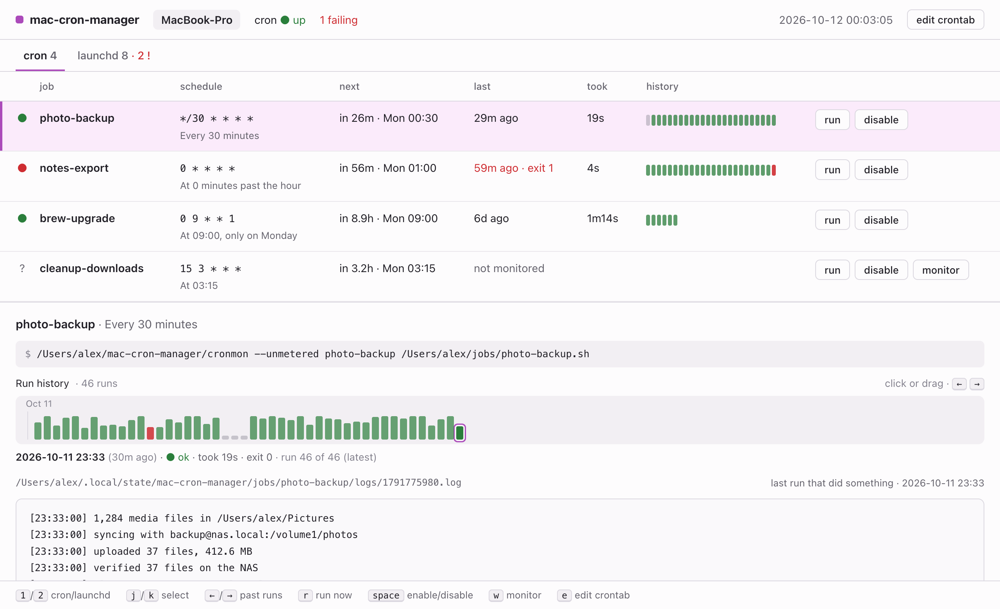
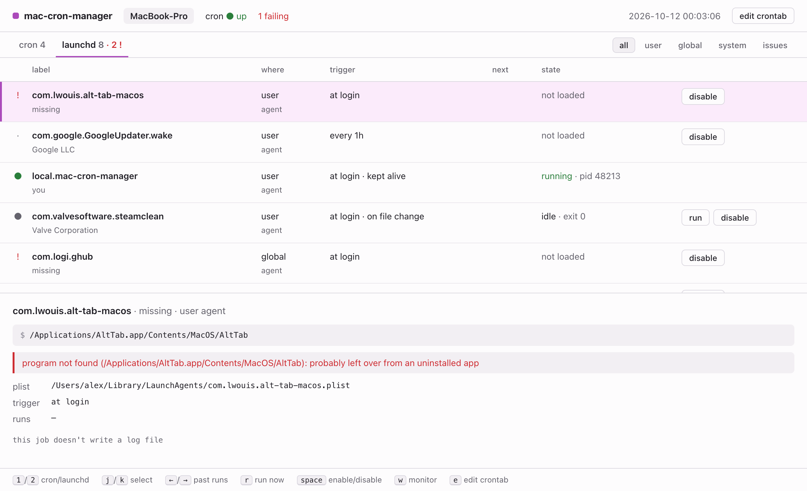

# mac-cron-manager

A small dashboard for the scheduled jobs on your Mac: see whether each cron job
actually ran, read the output of any past run, and spot the background agents
that uninstalled apps left behind.

<picture>
  <source media="(prefers-color-scheme: dark)" srcset="docs/images/cron-dark.png">
  
</picture>

- **Did it run?** Put `cronmon` in front of a job and every run is recorded:
  when it started, how long it took, its exit code and its output. Click or
  drag along the timeline to read any earlier run.
- **What else starts by itself?** The launchd tab lists the agents and daemons
  your apps have installed, and flags the ones whose app is gone.
- **Stays on your Mac.** A small local agent serves the dashboard at
  `127.0.0.1:7878`. Nothing is sent anywhere.

<picture>
  <source media="(prefers-color-scheme: dark)" srcset="docs/images/launchd-dark.png">
  
</picture>

Screenshots use made-up data.

## Install

Requires macOS and Python 3.10 or later.

```sh
git clone https://github.com/induction-axiom/mac-cron-manager ~/mac-cron-manager
~/mac-cron-manager/install.sh
```

Then open http://127.0.0.1:7878. It starts at login from now on.

## Use

Press **monitor** next to a job, or add `cronmon` and a name in front of its
command yourself:

```
*/30 * * * * ~/mac-cron-manager/cronmon photo-backup ~/jobs/photo-backup.sh
```

Add `--unmetered` after `cronmon` to skip a job while your Mac is on a phone
hotspot.

A few things about cron on macOS:

- Jobs that read `~/Pictures`, `~/Documents` or `~/Desktop` need **Full Disk
  Access** for `/usr/sbin/cron` (System Settings → Privacy & Security).
- Jobs don't run while your Mac is asleep, and aren't caught up afterwards.

To update, `git pull` and run `install.sh` again. To remove it, run
`install.sh --uninstall`.

## License

Copyright (C) 2026 Jong Luo. Licensed under the GNU Affero General Public
License v3.0 (AGPL-3.0). See [LICENSE](LICENSE).
